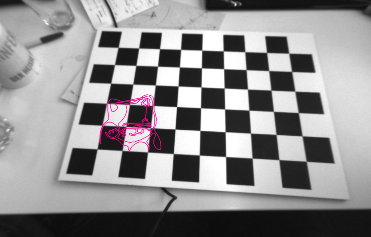
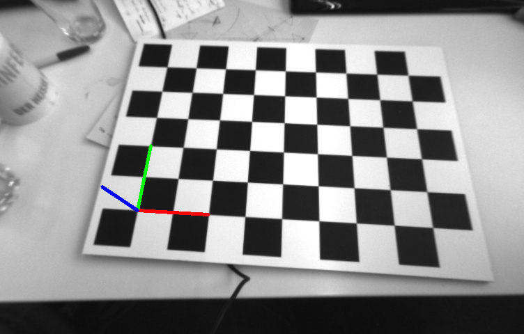

# Geometría proyectiva · Proyecto final

**Realidad aumentada desde cero sobre un tablero de ajedrez: cálculo de homografías, estimación de la pose de la cámara y proyección de figuras 2D y objetos 3D en una secuencia de vídeo, con Python y OpenCV.**

Es el proyecto final de la asignatura de Geometría Proyectiva del máster. A partir de una secuencia de 735 imágenes de un tablero de ajedrez y de la matriz intrínseca de la cámara, se calcula la homografía entre el tablero y cada imagen. Con ella se proyectan figuras sobre el plano del tablero, se recupera la rotación y la traslación de la cámara y, por último, se dibujan objetos 3D que siguen el movimiento del tablero en el vídeo.

La homografía y la descomposición de la pose se implementan a mano con NumPy. Las funciones equivalentes de OpenCV solo se usan como referencia para comparar resultados.

## Enlaces

- 🎥 **Vídeo explicativo:** [youtu.be/mHjOF1Phj2E](https://youtu.be/mHjOF1Phj2E)
- 🎥 **Vídeo de los resultados:** [youtu.be/SpjUjZRgdWA](https://youtu.be/SpjUjZRgdWA)
- 📁 **Resultados (imágenes, matrices y vídeos):** [`resultados/`](resultados)

## Partes del proyecto

| Parte | Qué hace | Resultado |
|---|---|---|
| **1. Homografía** | Detecta las esquinas del tablero, calcula la homografía y proyecta un cuadrado y un dibujo SVG sobre el plano | [`parte1_2.png`](resultados/parte1_2.png), [`parte1_3.png`](resultados/parte1_3.png), [`parte1_2_svg.png`](resultados/parte1_2_svg.png), [`parte1_H.txt`](resultados/parte1_H.txt) |
| **2. Proyección en vídeo** | Repite el proceso en cada fotograma para que la figura siga el tablero | [`parte2.mp4`](resultados/parte2.mp4), [`parte2_svg.mp4`](resultados/parte2_svg.mp4) |
| **3. Pose de la cámara** | Obtiene la rotación R y la traslación t a partir de la homografía y la matriz intrínseca K, y dibuja los ejes X, Y, Z | [`parte3.png`](resultados/parte3.png) y las matrices R y t |
| **4. Objetos 3D en vídeo** | Construye la matriz de proyección P = K[R\|t] en cada fotograma y dibuja un cubo y un modelo 3D (`.obj`) sobre el tablero | [`parte4.mp4`](resultados/parte4.mp4), [`parte4_obj.mp4`](resultados/parte4_obj.mp4) |

## Detalle de cada parte

### Parte 1: Cálculo de la homografía (`parte_1.py`)

- **Detección del tablero:** `cv2.findChessboardCorners` localiza los vértices internos del tablero. Como OpenCV los devuelve empezando por arriba a la izquierda y el sistema de referencia empieza abajo a la izquierda, se reordenan las coordenadas del plano para que coincidan.
- **Homografía implementada a mano (`findHomography`):**
  - Con la *Direct Linear Transformation* (DLT), cada correspondencia entre un punto del plano y uno de la imagen genera 2 restricciones, con las que se construye la matriz A.
  - Se aplica la descomposición en valores singulares (SVD) de A. Como la diagonal de S está en orden descendente, h es la última columna de V (la última fila de Vᵀ).
  - Se reorganiza h en una matriz de 3×3 y se normaliza para que h₉ = 1.
  - El resultado se puede comparar con `cv2.findHomography`.
- **Proyección sobre el plano:** se aplica la homografía a coordenadas homogéneas y se vuelve al plano euclídeo para dibujar:
  - un cuadrado alineado con los vértices del tablero
  - un cuadrado con puntos situados entre dos vértices
  - un dibujo vectorial (`gato.svg`), cuyos trazos se muestrean con `svgpathtools`, se normalizan y se escalan para que entren en el tablero

### Parte 2: Proyección en vídeo (`parte_2.py`)

Recorre todos los fotogramas, recalcula la homografía en cada uno con la función propia de la parte 1 y dibuja el cuadrado o el SVG. Los fotogramas se guardan en un vídeo MP4 a 30 FPS. Si en algún fotograma no se encuentra el tablero, se añade sin modificar para no romper la secuencia.

### Parte 3: Estimación de la pose de la cámara (`parte_3.py`)

A partir de la matriz intrínseca K y de la homografía H se calcula M = K⁻¹H, cuyas columnas son [r₁, r₂, t] salvo un factor de escala λ.

- **Primer método:**
  - λ se obtiene como la inversa de la media de las normas de r₁ y r₂.
  - Su signo se elige comprobando que det(R) = 1, donde r₃ = r₁ × r₂.
  - Al calcular RᵀR se ve que el resultado no es exactamente la identidad, así que **R no es una matriz de rotación válida**.
- **Segundo método (corregido):**
  - Se aplica SVD a las dos primeras columnas de M y se obtiene la rotación más cercana como R = UVᵀ.
  - Así R es ortonormal, con RᵀR = I y det(R) = 1.
- **Verificación visual:** se dibujan los ejes X, Y, Z sobre el tablero con `cv2.drawFrameAxes`.

### Parte 4: Objetos 3D en vídeo (`parte_4.py`)

En cada fotograma se calcula la homografía, se recupera R y t con el método de SVD de la parte 3 y se construye la matriz de proyección **P = K[R|t]**. Con ella se proyectan puntos 3D sobre la imagen para dibujar:

- un **cubo** definido por sus 8 vértices (base y tapa)
- un **modelo 3D de un avión** leído de un archivo `.obj` con un lector propio, al que se aplica escala y traslación antes de proyectarlo

## Tecnologías

- **Python 3.13**
- **NumPy** para el álgebra lineal (DLT, SVD, coordenadas homogéneas)
- **OpenCV** para la detección del tablero, el dibujo y la generación de vídeo
- **svgpathtools** para leer y muestrear archivos SVG

## Contenido del repositorio

- `parte_1.py` a `parte_4.py`: código de cada parte del proyecto.
- [`datos/`](datos): secuencia de imágenes del tablero, matriz intrínseca de la cámara (`K.txt`), dibujo vectorial (`gato.svg`) y modelo 3D (`avion.obj`).
- [`resultados/`](resultados): imágenes, matrices calculadas (H, R y t) y vídeos generados.

## Autora

Olaia Picabea
